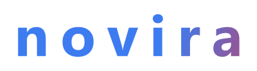

<p align="center">
  
</p>

<p align="center">
  画像生成 AI を自分のパソコンの中で使うデスクトップアプリです。
</p>

<p align="center">
  
  
  
  
  
  
</p>

---

novira は、プロンプトとモデルから絵を描くアプリです。絵を描くエンジンには ComfyUI を使います。ComfyUI と Python は初回の起動時に novira が自動でインストールするので、自分で用意する必要はありません。

絵を描く処理はすべてお使いのパソコンの中で行います。インターネットを使う機能（モデルの検索やダウンロードなど）は、使うことを選んだときだけ動きます。

> **0.1.0 はプレリリース版です。** 機能や画面は、これからも変わります。

## 目次

- [主な機能](#主な機能)
- [動作環境](#動作環境)
- [インストール](#インストール)
- [使いかた](#使いかた)
- [ブラウザとスマホで使う](#ブラウザとスマホで使う)
- [ソースから動かす](#ソースから動かす)
- [プライバシーとセキュリティ](#プライバシーとセキュリティ)
- [ドキュメント](#ドキュメント)
- [ライセンス](#ライセンス)

## 主な機能

| 機能 | できること |
|---|---|
| [画像をつくる](docs/manual/ja/02-generate.md) | プロンプトとモデルから絵を作ります。シード、高解像度補正、プリセット、参照画像、順番待ち（キュー）が使えます |
| [ギャラリー](docs/manual/ja/03-gallery.md) | 作った絵をボードで整理し、検索、絞り込み、2 枚の見比べができます。絵の生成情報から、設定を呼び出せます。透かし入りの共有用コピーも書き出せます |
| [絵を直す](docs/manual/ja/04-improve.md) | 作り直し、背景の除去、範囲を選んだ描き直し、顔の修正、絵からのプロンプト作成ができます。キャラクターの登録や比較グリッドも使えます |
| [キャンバス](docs/manual/ja/05-canvas.md) | レイヤーと描画ツールで、絵を描き足したり描き直したりします。コントロールレイヤーやポーズ（棒人間）も使えます |
| [アップスケールとワークフロー](docs/manual/ja/06-upscaling-workflows.md) | 絵を大きくします。ノードをつないで、自分だけの生成手順（ワークフロー）を作れます。ComfyUI の拡張機能も入れられます |
| [モデル](docs/manual/ja/08-models.md) | 入れたモデルを種類ごとに管理します。Civitai と Hugging Face でモデルを探して、インストールできます |
| [AI エージェント](docs/manual/ja/09-assistant-settings.md) | Claude Code や Codex、OpenAI 互換のサーバーにつないで、設定やプロンプトを相談できます |
| [スマホから使う](docs/manual/ja/13-phone.md) | 家の Wi-Fi のスマホから、ブラウザで操作できます |

動画・音楽・音声・ロゴ・テキスト・漫画の画面は開発中で、リリース版では表示されません。ソースから動かすと使えます（[動画・音楽など](docs/manual/ja/07-media.md)、[漫画](docs/manual/ja/12-comic.md)）。

画面の言語は、日本語、英語、中国語（簡体字・繁体字）、韓国語、ロシア語、スペイン語、ポルトガル語（ブラジル）、フランス語、ドイツ語から選べます。

## 動作環境

| 項目 | 内容 |
|---|---|
| OS | Windows 11 |
| GPU | NVIDIA 製の GPU が標準です。AMD 製は設定の「エンジン」で切り替えます |
| 空き容量 | ComfyUI と Python のほかに、モデルを置く場所が要ります。モデルは 1 つで数 GB あります |
| インターネット | 初回の起動時に、ComfyUI と Python をダウンロードします。モデルのダウンロードにも使います |

## インストール

1. Releases から `novira.exe` をダウンロードして起動します。
2. 初回の起動では、ComfyUI と Python のダウンロードとインストールが始まります。進み具合は起動画面に出ます。インストールは 1 回だけです。
3. 使い終わったら、アプリを閉じるだけです。データは `novira.exe` と同じ場所の `novira-data\` に保存されます。

## 使いかた

1. **モデル** タブ（または **探す** タブ）で、モデルを 1 つインストールします。
2. **生成** タブでモデルを選び、プロンプトを書いて **生成** を押します。
3. できた絵は、右のギャラリーに並びます。

詳しくは [マニュアル](docs/manual/ja/01-start.md) をご覧ください。困ったときの対処は [トラブルシューティング](docs/manual/ja/10-troubleshooting.md) にまとめています。

## ブラウザとスマホで使う

`scripts\server.bat` を実行して、表示されたアドレスをブラウザで開くと、アプリと同じ画面を使えます。接続を受け付けるのはこのパソコン（`127.0.0.1`）だけで、アドレスには起動ごとのトークンが付きます。アプリと同じデータを使うので、先にアプリを閉じてください。

スマホから使うときは、パソコンのブラウザの左のバーの **QR** を押します。

- 家の Wi-Fi 用の窓口は、パソコンの持ち主が一度「信頼する」と答えたネットワークでだけ開き、30 分使われないと閉じます。
- 通信は https で、このパソコンが作った証明書（novira local CA）で暗号化されます。スマホには証明書を一度入れてください。手順は、スマホに出る画面にあります。
- QR コードを読み取って「つなぐ」を押すと、パソコンに確認番号つきの許可が出ます。許可したスマホだけが使え、接続は 30 分使わないか 4 時間で切れます。
- スマホからは生成、ギャラリー、AI エージェントとの会話などが使えます。インストールや設定の変更はパソコンでだけできます。

Windows が接続の許可を尋ねたら、プライベート ネットワークで許可します。詳しくは [スマホから使う](docs/manual/ja/13-phone.md) をご覧ください。

## ソースから動かす

Releases にない版（開発中の最新など）を使うときは、ソースからビルドします。

| 必要なもの | 用途 |
|---|---|
| Windows 11 | 起動用のスクリプトが `.bat` で、アプリも Windows 向けです |
| Git | ソースの取得 |
| Node.js 22 以降 | 画面（フロントエンド）のビルド |
| Rust（rustup で入れる stable） | アプリ本体のビルド |
| Microsoft C++ Build Tools | Rust が Windows でビルドするのに使います。「C++ によるデスクトップ開発」を選んで入れます |
| WebView2 ランタイム | 画面の表示。Windows 11 には最初から入っています |

```bat
git clone https://github.com/valneko-twoon2/novira.git
cd novira\frontend
npm ci
cd ..
scripts\start.bat
```

最初のビルドは Rust の依存をすべてコンパイルするので数分かかります。2 回目からは変えた部分だけをビルドします。データはリポジトリ直下の `novira-data\` に置かれます（環境変数 `NOVIRA_DATA_DIR` で変えられます）。

| 起動のしかた | 中身 |
|---|---|
| `scripts\start.bat` | アプリをビルドして起動します。`start.bat fast` はビルドせずに起動します |
| `scripts\server.bat` | ブラウザ版のサーバーをビルドして起動します |
| `scripts\release.bat` | リリース用にビルドし、`artifacts\` に `novira.exe` などを置きます |
| `scripts\rebuild.bat` | 画面が崩れたときなどに、作り直してから起動します |
| `cd frontend` → `npm run dev` | エンジンなしで画面だけを確かめます（ブラウザで開くモック） |

起動中の `novira.exe` は Windows がロックするので、ビルドの前に閉じてください。開発の進め方とテストは [docs/development.md](docs/development.md)（英語）にあります。

## プライバシーとセキュリティ

- 絵を描く処理はパソコンの中だけで行います。
- インターネットを使うのは、モデルの検索とダウンロード、拡張機能のインストール、AI エージェントなど、使うことを選んだ機能だけです。
- AI エージェントを使うときは、相談の内容が、選んだ AI のサービスに送られます。作った絵やプロンプトを読ませるのは、設定で許可したときだけです。
- Civitai と Hugging Face の API キーは、Windows のアカウントで暗号化して保存し、画面には戻しません。
- ComfyUI はこのパソコンの中（`127.0.0.1`）だけで動かし、ネットワークには公開しません。
- ComfyUI の拡張機能やモデルは、入れたものをそのまま動かします。信頼できる配布元のものだけを入れてください。

守っている範囲と、分かっている制限は [docs/design/security.md](docs/design/security.md)（英語）にまとめています。

## ドキュメント

| 文書 | 内容 |
|---|---|
| [マニュアル](docs/manual/ja/01-start.md) | 使いかた。日本語と英語がそろっていて、ほかの言語は順次翻訳しています（[English](docs/manual/en/01-start.md)） |
| [docs/development.md](docs/development.md) | 開発環境の準備と、起動・検査のしかた（英語） |
| [docs/architecture/](docs/architecture/README.md) | ソースの構成と、変更の入口（英語） |
| [docs/design/](docs/design/README.md) | 機能ごとの現在の仕様、安全上の境界と制限（英語） |

## ライセンス

novira は [Apache License 2.0](LICENSE) で公開しています（[NOTICE](NOTICE)）。novira が使っているソフトウェアのライセンスは、[THIRD_PARTY_NOTICES.txt](THIRD_PARTY_NOTICES.txt) とアプリの「このアプリについて」に載せています。

モデルには、それぞれの作者が決めたライセンスがあります。商用利用の可否などはモデルのページで確かめてください。アプリのモデル一覧にも分かる範囲で表示しています。
